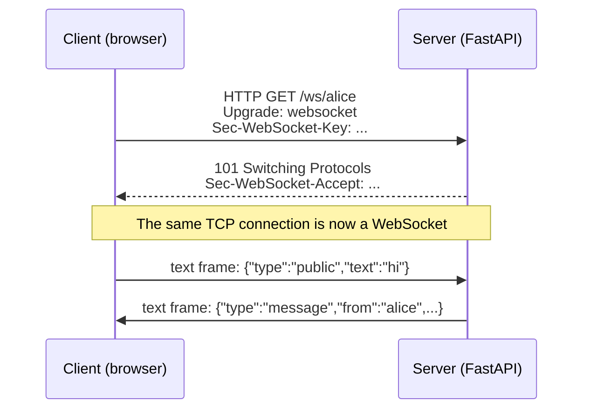
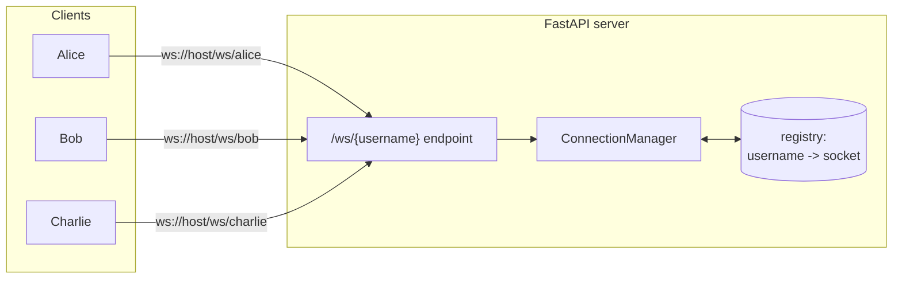
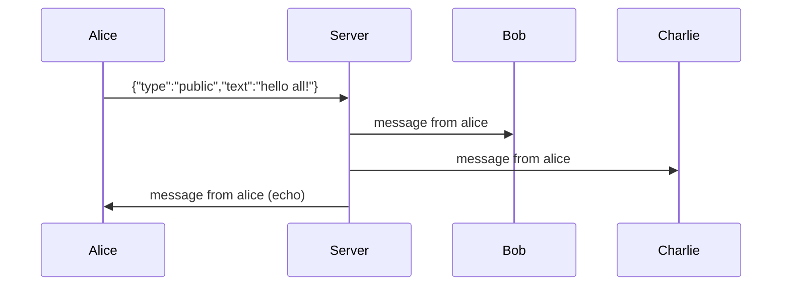
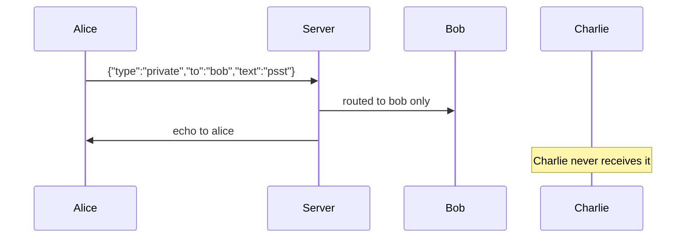

# WebSocket Messenger — a hands-on guide

A tiny real-time messenger built with **Python + FastAPI + WebSockets**.

Every user can send messages to two kinds of chat:

| Chat type | Who receives the message |
|---|---|
| **Public** | everyone who is connected |
| **Private** | only the one user you name (plus an echo back to you) |

Use this project to learn WebSockets by reading the code, running it, and
watching real messages travel. The concepts are explained below, from the
ground up.

---

## 1. The problem WebSocket solves

HTTP is *request → response*. The client asks, the server answers, the
connection is done. If you build a chat on plain HTTP, the client must keep
asking "any new messages?" over and over (polling) — slow and wasteful,
because most answers are "no".

A **WebSocket** is different: after one small HTTP handshake, the same TCP
connection **stays open**, and **both sides can send at any time**
(full-duplex). The server can push a message the moment it arrives.

```
HTTP (request / response)                  WebSocket (full-duplex)

Client            Server                   Client            Server
  │── request ────►│                         │── handshake ───►│
  │◄── response ───│  connection closed      │◄──── 101 ───────│
  │── request ────►│  (new connection)       │◄──►  messages flow
  │◄── response ───│  connection closed      │◄──►  anytime, both
  │── request ────►│  ...                    │◄──►  directions
```

| | HTTP | WebSocket |
|---|---|---|
| Direction | one-way per exchange (client asks first) | both ways, anytime |
| Connection | new one per request (or kept alive briefly) | one long-lived connection |
| Overhead | headers on every request | tiny frame header (2–14 bytes) |
| Good for | pages, APIs, file uploads | chat, games, live dashboards, notifications |

---

## 2. The handshake — how a WebSocket starts

A WebSocket **begins as a normal HTTP request**. The client asks the server
to "upgrade" the connection. If the server agrees, the same TCP socket
becomes a WebSocket.

The client sends special headers:

```
GET /ws/alice HTTP/1.1
Host: localhost:8000
Upgrade: websocket
Connection: Upgrade
Sec-WebSocket-Key: dGhlIHNhbXBsZSBub25jZQ==
Sec-WebSocket-Version: 13
```

The server answers with status `101 Switching Protocols`:

```
HTTP/1.1 101 Switching Protocols
Upgrade: websocket
Connection: Upgrade
Sec-WebSocket-Accept: s3pPLMBiTxaQ9kYGzzhZRbK+xOo=
```

`Sec-WebSocket-Accept` proves the server really speaks WebSocket: it is
`base64( sha1( key + "258EAFA5-E914-47DA-95CA-C5AB0DC85B11" ) )` — the key
from the request plus a fixed magic string defined by the RFC.



In FastAPI you never see these headers — `await websocket.accept()` does the
whole handshake for you (see `main.py`).

---

## 3. Frames — the data unit of a WebSocket

After the handshake, data travels in small packages called **frames**:

| Frame type | Purpose |
|---|---|
| `text` | strings — we put JSON in these |
| `binary` | raw bytes (images, files, audio) |
| `ping` / `pong` | keep-alive heartbeat, sent automatically by libraries |
| `close` | graceful shutdown, carries a close **code** + **reason** |

Note: WebSocket defines *how* bytes travel, not *what they mean*. The meaning
is **your app-level protocol**. In this project our protocol is **JSON text
frames** (see section 6). You could just as well send plain text or binary.

Close codes are numbers with meaning: `1000` = normal, `1001` = going away,
`4001` = our custom "username already taken".

---

## 4. Connection lifecycle

```
new WebSocket(url)
      │
      ▼
 CONNECTING ──── handshake (HTTP upgrade) ────► OPEN ◄──► send / receive anytime
                                                  │
                                            close frame
                                                  │
                                                  ▼
                                       CLOSING ────► CLOSED
```

On the browser side this maps to `readyState` 0 → 1 → 2 → 3 and the
`onopen` / `onmessage` / `onclose` events you see in `static/index.html`.

---

## 5. Architecture of this messenger

One important idea: **the WebSocket is only a pipe**. The server keeps a
registry of who is connected, and *our Python code* decides where each
message goes. There is no built-in "chat" logic in WebSocket.



| File | What it is |
|---|---|
| `main.py` | the server: WebSocket endpoint + routing logic |
| `static/index.html` | browser client (open it in multiple tabs) |
| `client.py` | terminal client (run it in multiple terminals) |
| `requirements.txt` | dependencies |

### The ConnectionManager

It is a simple class holding `{username: WebSocket}` and three operations —
this is the whole "router":

- `connect(username, ws)` — store the socket after the handshake
- `send_to(username, payload)` — private route (one socket)
- `broadcast(payload)` — public route (all sockets)
- `disconnect(username)` — remove the socket when the client leaves

---

## 6. Message protocol (our JSON on top of WebSocket)

### Client → server

| Field | Meaning |
|---|---|
| `type: "public"` | broadcast to everyone |
| `type: "private"` | route to one user only |
| `text` | the message body |
| `to` | recipient username (private only) |

Example: `{"type": "private", "to": "bob", "text": "psst"}`

### Server → client

| `type` | Fields | Meaning |
|---|---|---|
| `message` | `scope`, `from`, `to`, `text`, `time` | a chat message |
| `system` | `text`, `users`, `time` | someone joined/left + current online list |
| `error` | `text` | something went wrong (e.g. user offline) |

---

## 7. How messages flow

### Public message (broadcast)



The server loops over **all** sockets in the registry and sends to each.
Everyone sees it — including the sender, because a WebSocket has no
built-in echo.

### Private message (routing)



The server looks up `"bob"` in the registry and sends **only to that
socket**. If Bob is not online, Alice gets an `error` message back.

---

## 8. Run it

```bash
python3 -m venv .venv
.venv/bin/pip install -r requirements.txt
.venv/bin/uvicorn main:app --reload
```

Then:

- **Browser:** open http://localhost:8000 in two or three tabs, pick
  different usernames, and chat. Public messages reach everyone; switch the
  dropdown to Private, type a username, and only that user gets it.
- **Terminal:** open two or three terminals and run
  `.venv/bin/python client.py alice`, `.venv/bin/python client.py bob`, ...
  Type text for public chat, `/private bob hi there` for a DM, `/quit` to
  leave. Browser and terminal users can talk to each other.

---

## 9. Try these experiments

1. Open 3 tabs (alice, bob, charlie). Alice sends a public message — all 3 see it.
2. Alice sends a **private** message to bob — bob sees it, charlie does not.
3. Close bob's tab — everyone instantly gets a "bob left" system message.
4. Open a second tab with username "alice" — rejected with close code 4001.
5. Send a private message to someone offline — you get an error back.
6. Browser DevTools → Network → WS → click the connection → watch the real
   frames (the handshake, the JSON text frames, the close frame).

---

## 10. Key takeaways

- A WebSocket is an **upgraded HTTP connection** that stays open; both sides
  can send at any time (full-duplex).
- The server keeps a **registry of open sockets** and routes messages itself —
  WebSocket has no built-in rooms, chat, or routing.
- WebSocket carries **frames**; the *meaning* of the data is your app-level
  protocol (JSON here).
- One endpoint (`/ws/{username}`) handles all clients; the difference
  between public and private is just `broadcast` vs `send_to` in Python.

## 11. What this project simplifies

A real messenger adds more on top, but the core stays the same:

- **Auth** — verify who connects (tokens instead of a free username).
- **Rooms** — a `{room_id: set[usernames]}` structure next to the registry.
- **Reconnect** — clients must handle network drops and rejoin.
- **Heartbeats** — apps send ping/pong at the app level to detect dead peers.
- **Scaling** — the registry lives in one process's memory; multiple server
  instances need a shared message broker (e.g. Redis pub/sub).

Deeper dive: [`docs/broadcast-bottlenecks.md`](docs/broadcast-bottlenecks.md)
— where `broadcast` breaks first at scale, and the fixes in order.
