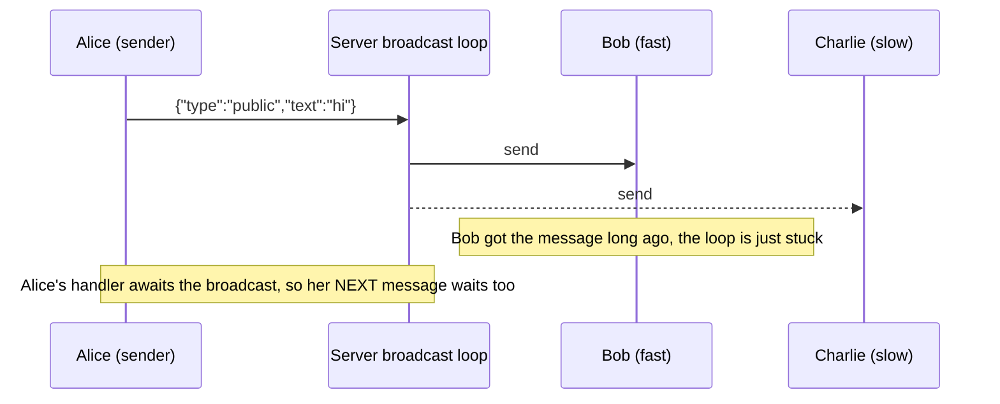
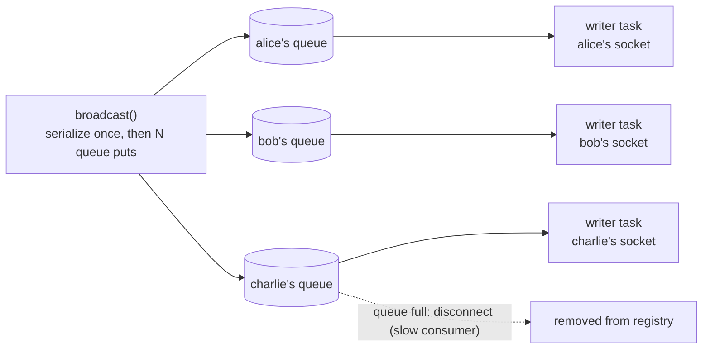
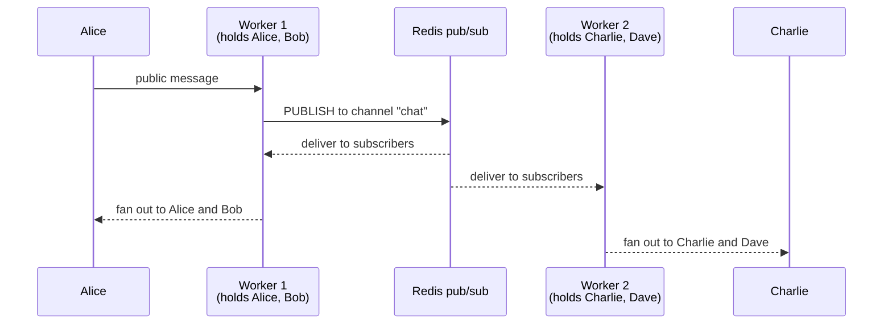

# Where `broadcast` becomes a bottleneck

This doc asks one question: **what breaks first when many users are connected?**

It refers to the current code in `main.py`:

```python
async def broadcast(self, payload: dict, exclude: str | None = None) -> None:
    """Send to every connected user (the public chat), optionally skipping one."""
    for username, ws in list(self.connections.items()):
        if username != exclude:
            await ws.send_json(payload)
```

One public message = one loop over all N connected users, one `await` per user.

---

## The bottlenecks, in the order they will hit you

### 1. A slow client stalls everyone (head-of-line blocking)

This is the first thing that breaks, and it breaks early.

Every socket has an OS-level send buffer. When the server writes and the
client does not read, the buffer fills up. Then the write **blocks** until
the client reads again. This is called TCP backpressure.

Our loop does the sends **one by one** and `await`s each. So one user on
slow Wi-Fi (or a tab that is frozen) blocks the whole loop — and everyone
after them in the loop gets the message late.



Notice the second effect: the sender's `while True` receive loop is awaiting
`broadcast()`. So **one slow receiver delays the sender's next message**.
The whole chat runs at the speed of the slowest user.

### 2. The work is linear, and part of it is duplicated

- **O(N) sends per message.** 1,000 users = 1,000 awaits per public message.
- **`send_json` serializes the same dict N times.** It calls `json.dumps`
  for every user, even though the text is identical for all of them. That is
  N × wasted CPU work.

Rough math: with 1,000 healthy users, one broadcast costs ~1,000 network
writes + ~1,000 `json.dumps` calls. That is roughly 100–500 ms, so the chat
manages only ~2–10 public messages per second. Fine for a small chat, too
slow for a live game or a busy feed.

### 3. One process = one registry = one CPU core

The registry `{username: WebSocket}` lives in **one process's memory**.

- You cannot just run `uvicorn --workers 4`: each worker would have its own
  registry. Alice (connected to worker 1) would never receive Bob's message
  (Bob is on worker 2). The app silently breaks.
- So the whole system is capped at what **one process on one CPU core** can
  do. Vertical scaling only.

### 4. The OS runs out of file descriptors

Every open WebSocket is one file descriptor (fd). The default soft limit on
most Linux systems is **1024**. Minus the fds used by the app itself, you
cannot pass roughly **1,000 simultaneous connections** without raising the
limit (`ulimit -n`). This one surprises beginners because the code looks
fine and the server just stops accepting connections.

### 5. Nothing protects you from slow or dead connections

- A client that stopped reading is never disconnected (see bottleneck 1).
- A client whose network died (no close frame) stays in the registry until
  TCP notices — minutes. Its socket holds an fd and gets every broadcast,
  making bottleneck 1 worse.

---

## Fixes, cheapest first

### Fix 1 — serialize once

```python
import json

async def broadcast(self, payload: dict, exclude: str | None = None) -> None:
    text = json.dumps(payload)          # once, not N times
    for username, ws in list(self.connections.items()):
        if username != exclude:
            await ws.send_text(text)    # send the same string to everyone
```

One line of logic, removes the N × `json.dumps` cost.

### Fix 2 — fan out concurrently

```python
async def broadcast(self, payload: dict, exclude: str | None = None) -> None:
    text = json.dumps(payload)
    await asyncio.gather(*(
        ws.send_text(text)
        for username, ws in self.connections.items()
        if username != exclude
    ), return_exceptions=True)
```

```
current (serial):                              fixed (parallel):

alice's msg ─► bob ─► charlie ─► dave           alice's msg ─┬─► bob
                                                             ├─► charlie
one slow user blocks the rest                               └─► dave
```

All sends start at once; a slow client only delays **itself**, not the
others. `return_exceptions=True` swallows errors from dead sockets instead
of aborting the whole broadcast.

### Fix 3 — per-user send queue + writer task (the standard pattern)

Real systems give every connection its own **outbound queue** and a writer
task. Broadcast then just does N fast queue puts (no network wait at all),
and a slow client only delays its own writer.

```python
class ConnectionManager:
    def __init__(self):
        self.connections = {}   # username -> WebSocket
        self.queues = {}        # username -> asyncio.Queue

    async def connect(self, username, websocket):
        await websocket.accept()
        self.connections[username] = websocket
        self.queues[username] = asyncio.Queue(maxsize=100)
        asyncio.create_task(self._writer(username, websocket))

    async def _writer(self, username, websocket):
        while True:
            text = await self.queues[username].get()
            await websocket.send_text(text)

    def disconnect(self, username):
        self.connections.pop(username, None)
        self.queues.pop(username, None)

    async def send_to(self, username, text):
        try:
            self.queues[username].put_nowait(text)
        except asyncio.QueueFull:
            # Slow consumer: drop them instead of letting them stall the chat.
            self.disconnect(username)

    async def broadcast(self, payload, exclude=None):
        text = json.dumps(payload)
        for username in list(self.connections):
            if username != exclude:
                await self.send_to(username, text)
```

The structure this code creates:



Key ideas:

- `maxsize=100` is the slow-consumer policy: a user who stops reading gets
  disconnected instead of growing memory forever.
- The broadcast never touches the network — it only puts strings on queues,
  so it returns in microseconds.
- (Sketch only: real code also cancels the writer task on disconnect and
  closes the socket.)

### Fix 4 — app-level heartbeats

Dead connections must be reaped. Standard trick: every client sends
`{"type": "ping"}` every ~20 seconds; the server replies `{"type": "pong"}`.
Server side, wait for the next message with a timeout:

```python
try:
    data = await asyncio.wait_for(websocket.receive_json(), timeout=60)
except asyncio.TimeoutError:
    break   # silent client -> treat as gone, finally block cleans up
```

If nothing arrives for 60 seconds, the connection is closed and removed
from the registry.

### Fix 5 — scale out with a message broker

When one process is not enough, you need many server processes and a shared
message bus (Redis pub/sub is the usual first choice):



The rule changes: **the registry becomes per-process, the routing becomes
the broker's job.**

1. Alice sends a public message to worker 1.
2. Worker 1 `PUBLISH`es it to the `chat` channel.
3. Every worker (including worker 1) is `SUBSCRIBE`d and receives it.
4. Each worker fans out **only to the users connected to it**.

Each worker now handles 1/k of the users, and the fan-out cost per worker
is divided by k. Redis pub/sub is ephemeral (no history) — for persistence
you add a database next to it.

### Fix 6 — OS limits

- `ulimit -n 65535` (or systemd `LimitNOFILE=`) to raise the fd cap.
- Tune socket buffers if needed: `sysctl net.ipv4.tcp_wmem`.

---

## How many users is "many"?

| Connected users | What breaks first | What to do |
|---|---|---|
| < 100 | nothing | current code is fine |
| 100s | one slow client stalls the loop | Fix 1 + 2 |
| ~1,000 | fd limit (1024), serialization cost, dead connections pile up | Fix 3 + 4 + `ulimit -n` |
| 10,000s | one process / one core ceiling | Fix 5 (broker) + everything above |

---

## Bottom line

The loop count is **not** the real problem. The real problems, in order:

1. The loop is **sequential and waits for the slowest client** (backpressure).
2. Everything lives in **one process's memory** (registry, and therefore routing).
3. There is **no slow-consumer policy and no dead-connection cleanup**.

Fixes 1 and 2 are a ~5-line change to `main.py` and remove the most common
pain; the queue pattern (Fix 3) is what every real chat server uses; the
broker (Fix 5) is what you need only when one box is truly not enough.
